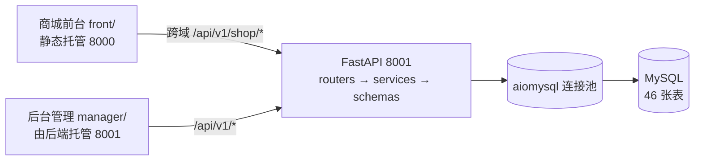

# 随心商城（shop_demo）

前后端分离的商城管理系统完整交付包：FastAPI 后端 API + MySQL、商城后台管理系统/管理端（`manager/`）、商城前台（`front/`）。
后端已实现 RBAC/商品/订单等核心接口，接口契约遵循 `specs/商城后台管理系统V2.spec.md`。

## 亮点速览

[](./LICENSE)
[](https://www.python.org/)
[-blue.svg)](./CONTRIBUTING.md)

FastAPI + aiomysql 全异步电商系统 · 46 张表 · 21 个路由模块 · 28 个后台页 / 18 个前台页 · 84 个测试通过

| 场景 | 怎么做的 | 代码位置 |
|---|---|---|
| **库存超卖** | SKU 库存单语句条件扣减 `UPDATE ... WHERE stock >= N`，影响行数为 0 直接报库存不足，与建订单同处一个事务 | `backend/app/services/shop_order.py` |
| **重复下单** | 结算预览签发 `previewToken`（15 分钟有效），下单时原子弹出并校验归属与时效，同一凭据只能成交一次 | 同上 |
| **越权 / 提权** | 权限码 + `data_scope` 行级数据隔离；角色与权限的写操作经 `require_super_admin` 闸门收口到超管，普通管理员携带的角色字段会被丢弃；另有 10 个回归用例锁住四条提权链路 | `core/deps.py`、`services/permission.py`、`tests/test_privilege_escalation.py` |
| **会话隔离** | 管理端与前台各有独立密钥配置项 `JWT_SECRET` / `MEMBER_JWT_SECRET`，解码时还校验令牌类型 `typ`，两套令牌不能互换；`MEMBER_JWT_SECRET` 留空时会回落到 `JWT_SECRET`，显式配置才算真正隔离 | `core/config.py`、`core/security.py` |
| **统一分层** | `routers`（鉴权与入参）→ `services`（业务与事务）→ `aiomysql`（连接池），路由层不写 SQL | `backend/app/` |



> 上表各项的实现位置见右列「代码位置」，可直接对照源码核对。

> **开源声明 / Disclaimer**
> 本项目是一个由 AI 辅助构建的商城系统学习/演示项目，代码按 [MIT License](./LICENSE) 发布。
> 仓库内的品牌名称、商标、产品命名以及商品图片均为演示占位数据，仅用于展示系统功能，与任何真实品牌、厂商均无关联，也不代表对其产品或服务的认可。
> 商品演示图均为自绘 SVG 占位图，不涉及任何第三方图片版权；站点 logo 由本项目作者起草后借助 AI 生成，**据作者所知**未包含第三方商标或受版权保护的美术元素（AI 生成内容的权利归属在各司法辖区尚存争议，本项目不对其主张独占性权利）。如认为相关内容涉及您的权利，请提 Issue 联系，将第一时间删除。
> 商品名与型号为虚构编号，如与真实产品型号相近纯属巧合，无任何关联暗示。

<p align="center"></p>

> **访问入口（运行端口分离）**：
> - 后端接口服务 + 后台管理系统 `manager/`（含登录）统一运行在 **8001 端口**：`http://127.0.0.1:8001`（根路径自动跳转 `/manager/login.html` 登录页）。
> - 商城前台 `front/` 独立静态托管在 **8000 端口**：`http://127.0.0.1:8000/`（站点根=`front/` 目录，根路径即商城首页；已按 `specs/商城前台V1.2.spec.md` 接入 `/api/v1/shop/*` 真实接口，跨域调用 8001）。
> 操作步骤与各页面功能说明见独立文档 **[操作手册.md](./操作手册.md)**。

> **完全没接触过编程？** 直接跳到 **[§3 从零跑起来](#3-从零跑起来跟着做就能看到页面)**，照着复制粘贴命令即可，每一步都写了「成功了应该看到什么」。

## 1. 技术栈与运行环境

| 组件 | 技术 |
|---|---|
| 后端 | Python 3.10+、FastAPI、uvicorn、aiomysql（全异步） |
| 数据库 | MySQL 5.7+（推荐 8.0） |
| 前端 | 原生 HTML/CSS/JS，无构建步骤 |
| 认证 | JWT + bcrypt |
| 依赖管理 | uv（`pyproject.toml` + `uv.lock`，`uv add` 新增依赖） |
| 测试 | pytest（依赖真实 MySQL） |

## 2. 目录结构

```
shop_demo/
├── backend/                # 后端 API 服务（监听 8001）
│   ├── app/
│   │   ├── main.py         # FastAPI 入口（自动注册路由 + 托管 manager 管理端静态页面）
│   │   ├── core/           # 配置/数据库连接池/JWT/鉴权依赖/统一响应/操作日志
│   │   ├── routers/        # 路由（auth / permission / goods / orders / member / shop 等）
│   │   ├── services/       # 业务逻辑层（snake_case ↔ camelCase 转换在此层）
│   │   └── schemas/        # Pydantic 入参模型
│   ├── seed/               # 数据初始化（schema 建表 / base 基础数据 / demo 演示数据）
│   ├── tests/              # pytest
│   ├── pyproject.toml      # uv 依赖声明（uv init 生成）
│   ├── uv.lock             # uv 锁定版本（源地址统一为官方 PyPI）
│   ├── requirements.txt    # 不用 uv 时的运行时依赖清单（pip install -r requirements.txt）
│   ├── requirements-dev.txt# 开发/测试依赖（pytest、httpx，跑测试时额外装）
│   ├── .env.example        # 环境变量模板（复制为 .env）
│   └── run.py              # 后端启动脚本（默认 8001 端口）
├── manager/                # 商城后台管理系统/管理端（静态页面，8001 随后端托管）
├── front/                  # 商城前台（静态页面，18 页购物闭环，8000 端口独立静态托管）
├── uploads/                # 运行期上传目录（seed/ 下的演示图入库，其余忽略）
├── docker-compose.yml      # 一键启动 MySQL（不想手工装数据库时用这个）
├── specs/                  # 需求规格文档（单一事实来源）
├── docs/                   # 项目变量、前台设计记录、开发指南
├── CONTRIBUTING.md         # 贡献指南（提交规范与 PR 清单）
├── 操作手册.md              # 操作手册（启动/访问地址/页面功能）
└── 后台管理系统功能.md      # 业务功能说明
```

> 目录结构约定：`manager/pages/<模块>/xxx.html` 固定为两级，公共资源统一引用 `../../css`、`../../js`；
> `js/common.js` 的侧边栏菜单会自动按当前页面深度计算跳转前缀，页面新增/移动后无需改菜单路径，但请保持该目录层级不变。

---

## 3. 从零跑起来（跟着做就能看到页面）

> 全程只需复制粘贴命令。**建议把项目放在不含中文和空格的路径下**，例如 `C:\shop-open`、`~/shop-open`，能避免大量莫名其妙的报错。
>
> 命令在 **终端** 里执行：Windows 用「PowerShell」（开始菜单搜索 PowerShell 即可），macOS 用「终端」，Linux 用任意 Shell。

### 3.1 安装 Python（必须先做）

到 <https://www.python.org/downloads/> 下载 3.10 或更高版本的安装包。

> **Windows 用户特别注意**：安装界面最下面有个 **「Add python.exe to PATH」**，必须勾选后再点 Install。忘了勾的话，重新运行安装包 → 选 Modify → 补勾即可。

装完后 **关掉终端重新打开一个新的窗口**，执行：

```bash
python --version
```

**成功标志**：显示版本号，例如 `Python 3.12.4`。

| 如果失败 | 怎么办 |
|---|---|
| 提示「不是内部或外部命令」 | PATH 没勾，见上面的注意项 |
| macOS / Linux 报 command not found | 改用 `python3 --version`；后续所有命令里的 `python` 都换成 `python3` |

### 3.2 把项目弄到电脑上

#### 方式一：下载压缩包（最简单，不需要装 git）

打开本项目的 GitHub 页面 → 点绿色 **Code** 按钮 → **Download ZIP** → 解压到你选好的目录。

> ⚠️ 解压出来的文件夹很可能叫 **`shop-open-main`**（GitHub 会自动加上分支名）。请把它 **右键重命名成 `shop-open`**，这样后面所有命令才能和你看到的完全一致。
> 建议解压到自己的用户目录下（如 `C:\Users\你的用户名\` 或 `~/`），不要直接放在 `C:\` 根目录 —— Windows 在 C 盘根目录创建文件夹常会弹出权限拒绝。
> 记下这个文件夹的完整路径：Windows 形如 `C:\Users\你的用户名\shop-open`，macOS / Linux 形如 `~/shop-open`。下面命令里出现这个路径时，**换成你自己的**。

#### 方式二：用 git 克隆

先装 git：<https://git-scm.com/downloads>（全程下一步即可）。然后：

```bash
git clone https://github.com/<你的GitHub用户名>/shop-open.git
cd shop-open
```

> 若你 fork 或换到别的仓库地址：在 GitHub 项目页点绿色 **Code** → 复制 HTTPS 那个链接，整行替换掉上面这条 `git clone` 后面的部分即可。
> 用 git 方式得到的文件夹名就是 `shop-open`，不需要重命名。

### 3.3 准备数据库（两条路，二选一）

#### 路线 A：用 Docker（推荐，最省事，不需要理解 MySQL）

先装 Docker Desktop：<https://www.docker.com/products/docker-desktop/>，装完启动它，等左下角状态变成绿色 Running。

在**项目根目录**（就是刚才那个 `shop-open` 文件夹）执行：

```bash
cd C:\Users\你的用户名\shop-open    # Windows；macOS/Linux 用 cd ~/shop-open
docker compose up -d
```

> 上面路径换成你自己的解压目录。Apple Silicon（M1/M2/M3）的 Mac 若容器起不来，打开 `docker-compose.yml`，把 `# platform: linux/amd64` 这行开头的 `# ` 删掉再重试。

**成功标志**：出现 `Container shop-open-mysql Started` 之类的字样。**首次会下载镜像，需要等 1~10 分钟**，下载完还要等约 30 秒让数据库初始化完成。可以用下面命令确认就绪：

```bash
docker compose ps
```

看到状态是 `healthy` 才算准备好；如果是 `starting`，耐心等一会儿再看。

> 这条命令会自动起一个 MySQL 8，账号 `root`、密码 `DEV_ONLY_123456`、库名 `aaashop`。
> 后面的步骤里，路线 A 的用户需要在 `.env` 中把 `DB_PASSWORD=` 改成 `DB_PASSWORD=DEV_ONLY_123456`。
>
> 关于这个口令：`DEV_ONLY_123456` 只是让新手零配置跑通第一次的**本机演示值**，
> 容器端口只绑定 `127.0.0.1`（局域网连不上）。想换成自己的口令，二选一：
>
> PowerShell（Windows，本项目默认终端）：
>
> ```powershell
> $env:DB_PASSWORD='你的强口令'; docker compose up -d    # 方式一：命令行临时指定
> docker compose --env-file .env.db up -d                # 方式二：把 DB_PASSWORD=你的强口令 写进 .env.db
> ```
>
> macOS / Linux（`bash`/`zsh`）写法不同，是 POSIX 式前缀赋值：
>
> ```bash
> DB_PASSWORD=你的强口令 docker compose up -d
> ```
>
> ⚠️ 注意别把这两种混用：`DB_PASSWORD=xxx docker compose up -d` 在 PowerShell 里会报
> 「无法将 DB_PASSWORD=xxx 识别为 cmdlet」，因为 PowerShell 不支持这种临时变量前缀。
>
> ⚠️ Docker Compose 只会自动读取项目根目录的 `.env`，**不会**自动读 `.env.db`；
> 直接 `docker compose up -d` 时 `.env.db` 里的口令不生效，容器仍用 `DEV_ONLY_123456`。
> 换口令后记得同步改 `backend/.env` 里的 `DB_PASSWORD`，否则 seed 会报 `1045 Access denied`。

> 若报 `ports are already allocated`：你本机已装过 MySQL，3306 端口被它占了 —— 改用下面的路线 B，或先停掉本机的 MySQL 服务。
> 若报 `docker` 命令不存在或 daemon 未运行：Docker Desktop 没启动，打开它并等左下角变绿后重试。

#### 路线 B：本机安装 MySQL

不想装 Docker，就在本机装 MySQL 8：

| 系统 | 做法 |
|---|---|
| Windows | 下载 <https://dev.mysql.com/downloads/installer/> （选 mysql-installer-community），安装类型选 **Server only**，一路下一步，**记住你设置的 root 密码** |
| macOS | `brew install mysql` 然后 `brew services start mysql` |
| Linux | `sudo apt install -y mysql-server` 然后 `sudo systemctl start mysql` |

**怎么确认装好了**：能连得上就是好的。执行 `mysql -uroot -p`，回车后：

- 直接进了 `mysql>` 提示符 = root **无密码**，后面 `.env` 里 `DB_PASSWORD` 保持留空
- 要输密码才能进 = root **有密码**，把这个密码填到 `.env` 的 `DB_PASSWORD`

> Windows 上若 `mysql` 命令不存在，用开始菜单里的 **MySQL Command Line Client** 代替即可，不影响后续操作。

### 3.4 安装 Python 依赖

打开终端，**先进入 backend 目录**（把路径换成你自己的）：

```bash
cd C:\Users\你的用户名\shop-open\backend    # Windows
# macOS / Linux 用：cd ~/shop-open/backend
```

> 上面的路径换成你自己的解压目录。怎么快速进目录？
> Windows：在资源管理器里进到 `backend` 文件夹，在地址栏输入 `powershell` 回车，终端就会停在这个目录。
> macOS：访达里右键 `backend` 文件夹 → 服务 → 「新建位于文件夹位置的终端窗口」。
> Linux：文件管理器里右键 → 在终端中打开。

装依赖工具 **uv**：

复制这一行执行即可（三系统通用）：

```bash
pip install uv
```

> Windows 若报「pip 不是内部或外部命令」，改用 `python -m pip install uv`；无法联网时可用官方脚本（Windows PowerShell：`irm https://astral.sh/uv/install.ps1 | iex`，macOS/Linux：`curl -LsSf https://astral.sh/uv/install.sh | sh`），脚本方式若被系统拦截（提示"禁止运行脚本"），回到上面的 `pip install uv` 即可。

> 装完 uv 请 **关掉终端重开一个窗口**，再执行下面的命令，否则可能提示找不到 uv。

验证 uv 装好了：

```bash
uv --version
```

**成功标志**：显示 `uv 0.x.x`。然后安装项目依赖：

```bash
uv sync
```

**成功标志**：出现 `Resolved`/`Installed ... packages` 等字样，且 `backend` 目录下多出一个 `.venv` 文件夹。首次执行需要下载，耐心等待。

> 卡住不动 / 下载极慢：用**环境变量**临时走镜像，只影响本机这一次安装（PowerShell）：
> `$env:UV_DEFAULT_INDEX='https://pypi.tuna.tsinghua.edu.cn/simple'; uv sync`
>
> ⚠️ 不要为了加速去改 `pyproject.toml` 里的 `[[tool.uv.index]]`，也不要把 `uv.lock` 提交成镜像源版本 ——
> 那等于让所有克隆项目的人都被指到一个第三方下载地址上去。

### 3.5 创建配置文件

**在 backend 目录下**执行：

| 系统 | 命令 |
|---|---|
| Windows（PowerShell） | `cp .env.example .env` |
| Windows（CMD） | `copy .env.example .env` |
| macOS / Linux | `cp .env.example .env` |

**成功标志**：`backend` 目录里出现 `.env` 文件。（Windows 资源管理器看不到带点开头的文件时，点「查看 → 显示 → 隐藏的项目」。）

然后用记事本打开 `backend/.env`，**必须改两处**：

**① `JWT_SECRET=` 后面填一串随机密钥。** 先生成密钥，在终端执行：

```bash
python -c "import secrets;print(secrets.token_urlsafe(48))"
```

把输出的一长串（形如 `Xy7...-9aQ`）**原样粘贴**到 `.env` 里，让它变成一行 `JWT_SECRET=<你刚才生成的那串>`：

```
JWT_SECRET=把上一步生成的那一整串粘贴到这里
```

> 等号后面**直接粘贴**，不要加引号、不要留空格，也不要照抄上面这行中文——这里只是告诉你填在哪。
> 这一项不填，下一步启动会直接报错。macOS / Linux 把 `python` 换成 `python3`。

**② `DB_PASSWORD=` 按你的情况填：**

| 你的情况 | 怎么填 |
|---|---|
| Docker 路线 A | `DB_PASSWORD=DEV_ONLY_123456` |
| 本机 MySQL，root 无密码 | 保持 `DB_PASSWORD=` 什么都不填 |
| 本机 MySQL，root 有密码 | `DB_PASSWORD=你的密码` |

其余变量全部保持原样不用动。

### 3.6 初始化数据（自动建库建表）

还在 `backend` 目录，执行：

```bash
uv run python -m seed.runner base
```

**成功标志**：滚动若干行 `[seed] ...`，最后出现类似：

```
[seed] 已创建默认管理员 admin，初始密码：<此处为随机生成的口令，每次不同>（请登录后立即修改）
base 数据完成
```

> **把这串密码记下来**，第 4 步登录要用。它每次都是随机生成的（仓库模板里没有写死任何口令）。
> 想自己指定：在 `.env` 里填 `ADMIN_INIT_PASSWORD=你的密码` 再跑 `seed base`。

> 括号里的「（请登录后立即修改）」是固定提示文案，不是报错。
> 重跑 `base` 时如果管理员已经存在，这行密码提示不会再次打印，只出现最后一行 `base 数据完成` —— 这是正常的。

> 库不用你建，这条命令会自动创建 `aaashop` 数据库和全部数据表。

接着灌入演示数据（商品、订单、会员等）：

```bash
uv run python -m seed.runner demo
```

**成功标志**：末尾出现 `demo 数据完成`。这一步耗时几十秒属正常，中途不要按 Ctrl+C。

> 只跑 `base` 不跑 `demo` 也能启动，但前台会一片空白（没有商品数据），且跑测试会失败。想看到完整效果就两个都跑。

### 3.7 启动（需要两个终端窗口）

**终端窗口 ① —— 启动后端与管理后台**

```bash
cd C:\Users\你的用户名\shop-open\backend    # Windows；macOS/Linux 用 cd ~/shop-open/backend
uv run python run.py
```

**成功标志**：出现下面这行，并且光标停住、**不再回到命令提示符**（这是正常的，说明服务在运行）：

```
INFO:     Uvicorn running on http://127.0.0.1:8001 (Press CTRL+C to quit)
```

> ⚠️ **这个窗口全程不要关，关了服务就停了。**

**终端窗口 ② —— 启动商城前台**（另外开一个新窗口，上面那个别动）

```bash
cd C:\Users\你的用户名\shop-open\front      # Windows；macOS/Linux 用 cd ~/shop-open/front
python -m http.server 8000
```

**成功标志**：出现 `Serving HTTP on 0.0.0.0 port 8000` 且不返回命令提示符。

> 这个窗口同样不要关，路径换成你自己的解压目录。
> 快速进目录的小技巧：Windows 在资源管理器里进到该文件夹，在地址栏输入 `powershell` 回车；macOS 在访达里右键文件夹 → 服务 → 「新建位于文件夹位置的终端窗口」；Linux 在文件管理器里右键 → 在终端中打开。
> macOS / Linux 若报 command not found，把 `python` 换成 `python3`。

### 3.8 验收：看到这 4 件事就成功了

打开浏览器（Edge / Chrome），确认刚才那两个黑窗口都还开着，然后把下面的地址依次粘贴到**地址栏**回车：

| # | 打开这个地址 | 应该看到 |
|---|---|---|
| 1 | http://127.0.0.1:8001 | 自动跳转到后台登录页 |
| 2 | 用 `admin` + 上一步 `seed base` 打印的那串初始密码登录 | 进入仪表盘，左侧有菜单，右上角显示 admin |
| 3 | http://127.0.0.1:8001/api/v1/health | 页面显示 `"db":"up"` 字样（数据库已连上） |
| 4 | http://127.0.0.1:8000/ | 商城首页，能看到商品列表和图片 |

四项全对，**安装完成**。任何一项不对，到本文后面的 **§9 常见问题** 按症状查。

> 后台账号：`admin`，密码是第 2 步 `seed base` 输出里打印的那串（随机生成，每人不同）
> 前台演示会员：`10000000001` / `123456`
> 前台**注册**验证码：每次随机生成，`SMS_MOCK=true` 时点「获取验证码」后会在页面上直接显示（演示通道没有真实短信，界面同时会写明「未真实发送短信」）

---

## 4. 详细配置说明

> 只是想把项目跑起来的话，**上面 §3 就够了**，这一节是给想调整配置的人看的。
> 要按自己的需求改项目？先看 **[docs/开发指南.md](./docs/开发指南.md)**（架构总览、加接口/加表/加页面的步骤、坑位清单）；提交改动请看 **[CONTRIBUTING.md](./CONTRIBUTING.md)**。

### 4.1 环境变量

`.env` 常用变量说明（全部可选项见 `backend/.env.example`，文件内每项都有中文注释）：

| 变量 | 默认值 | 说明 |
|---|---|---|
| DB_HOST / DB_PORT | 127.0.0.1 / 3306 | MySQL 地址 |
| DB_USER / DB_PASSWORD | root / 空 | 数据库账号；本地 root 无口令时 `DB_PASSWORD` 留空即可，有口令才填。**仓库不含任何个人或生产环境凭据**，文中出现的口令全部是「可替换的本地演示值」；部署到内网/公网前必须替换 |
| DB_NAME | aaashop | 数据库名（seed 会自动建库，无需手工创建） |
| DB_POOL_MIN / DB_POOL_MAX | 2 / 10 | 连接池大小；并发高时出现请求卡住可调大 `DB_POOL_MAX`（不超过 MySQL 的 `max_connections`） |
| JWT_SECRET | **必填，无默认值** | JWT 签名密钥，缺失时服务启动即报错；生成：`python -c "import secrets;print(secrets.token_urlsafe(48))"` |
| MEMBER_JWT_SECRET | 空（回退 JWT_SECRET） | 会员端令牌密钥，多服务部署建议独立配置 |
| SMS_MOCK | false | 短信演示通道开关。**true = 不真实下发**：验证码改为随机生成、BCrypt 哈希落 `sms_codes` 表，并通过响应字段 `devCode` 回显；**false = 通道不可用**（本项目未内置任何短信服务商 SDK），注册也随之停用。曾默认 true 且用固定 `123456`，现不再支持固定码 |
| ADMIN_INIT_PASSWORD | 空（随机生成） | `seed base` 用来设置管理员 admin 口令的值，**对已存在的 admin 同样会同步**（幂等）。留空时首次创建会打印一串随机密码（推荐，仓库不含任何可用口令）；跑 pytest 前需填上并确保值一致 |
| JWT_EXPIRE_MINUTES | 120 | Token 有效期（分钟） |
| GOODS_AUDIT_ENABLED | false | 新商品审核流开关 |
| CORS_ORIGINS | 见 `.env.example`（含 localhost 与 127.0.0.1 各 8000/8001） | 跨域白名单，**禁止使用 `*`** |
| PORT | 8001 | 后端监听端口 |
| RELOAD | 0 | 置 1 开启 uvicorn 热重载（仅开发用） |
| UPLOAD_DIR / UPLOAD_MAX_MB | uploads / 5 | 上传目录与单文件大小上限 |
| UPLOAD_PUBLIC_BASE | 空（按请求 host 生成） | 上传文件对外 URL 前缀；部署在反向代理/HTTPS 域名后需显式设置 |
| STATIC_MANAGER_DIR | 仓库根 `manager/` | 管理端静态目录（按文件位置自动解析，一般无需配置；确实要改请填绝对路径） |

> 用记事本编辑 `.env` 后如需保留为 UTF-8，请选「另存为 → 编码 UTF-8」。程序已兼容带 BOM 的文件，但编码混乱仍可能导致 `xxx` 之类的解析问题。

### 4.2 数据库

数据库无需手工创建：`python -m seed.runner` 任一子命令都会先执行 `CREATE DATABASE IF NOT EXISTS`（utf8mb4 / utf8mb4_general_ci）。

账号无 CREATE 权限时才需手动建库（seed 会打印对应语句）：

```
CREATE DATABASE IF NOT EXISTS aaashop DEFAULT CHARACTER SET utf8mb4 COLLATE utf8mb4_general_ci;
```

> MySQL 版本低于 5.7 时 seed 会直接提示并要求升级，不会给出看不懂的 SQL 报错。
> 排序规则必须与上面一致（`utf8mb4_general_ci`），否则查询可能出现 `Illegal mix of collations`。

### 4.3 seed 数据初始化

seed 与业务代码零耦合、全部幂等，只通过命令执行（在 `backend/` 目录下）：

```
uv run python -m seed.runner base        # 建表 + 基础数据（部门/角色/权限树/管理员/快递/等级/系统配置）
uv run python -m seed.runner demo        # 演示数据（分类/品牌/20 个商品/36 张商品占位图/24 个 SKU/6 个会员/18 个订单/评价/地址/优惠券/售后等，可整删）
uv run python -m seed.runner clean-base  # 清空基础数据（不影响演示数据）
uv run python -m seed.runner clean-demo  # 清空演示数据（不影响基础数据）
```

不带参数时默认执行 `base`。

- 首次初始化：`base` → `demo`。
- `demo` 按业务键幂等（商品/图/SKU 按 id、订单按单号、会员按手机号、流水类按“会员+事由/订单+动作”查重）：**重复执行只补齐缺失数据，不会翻倍**；需要完全重来才先 `clean-demo` 再 `demo`。
- 开源后新增了权限码/配置项？重跑 `seed base` 会幂等补齐并自动授予 admin 角色，不用清库。
- 演示图片：`demo` 会自动把项目内 `front/images/` 的图片同步到 `uploads/seed/` 并在数据中写入可访问 URL（默认 `http://127.0.0.1:8001/uploads/seed/*.svg`，可用 `UPLOAD_PUBLIC_BASE`/`PORT` 覆盖）。若输出显示「0 张新增/更新」，说明 `front/images/` 缺失，图片会裂。

### 4.4 端口分工与静态托管

- **8001**：后端接口 + 后台管理系统 `manager/`。启动：`cd backend && uv run python run.py`。接口文档 <http://127.0.0.1:8001/api/docs>，健康检查 <http://127.0.0.1:8001/api/v1/health>。
- **8000**：商城前台 `front/`。启动：`cd front && python -m http.server 8000`。访问根路径 <http://127.0.0.1:8000/>，**没有 `/front/` 前缀**。

> `manager/` 由后端在 8001 同源托管，页面调 `/api/v1/*` 无跨域问题。
> 前台跨域调用 8001，后端默认已放行 `http://127.0.0.1:8000`。若你习惯用 `localhost` 打开，默认白名单里也已包含，无需改配置。
> 建议在 `backend/` 目录内启动（目录按仓库根解析，其他目录也能挂载 `/manager`）。

### 4.5 运行自动化测试

```
cd backend
uv run pytest -q tests
```

前置（缺一不可）：

1. MySQL 可达，且已执行 `seed base` 与 `seed demo`
2. `.env` 已配置（`cp .env.example .env` 并至少填好 `JWT_SECRET`）—— 缺 `JWT_SECRET` 会在导入阶段直接报错，**一个用例都收集不到**
3. `.env` 里设置了 `ADMIN_INIT_PASSWORD` 且它与本机 admin 当前口令一致 —— 测试**不会**用默认口令兜底，没设的用例会 skip。口令不一致时执行 `uv run python -m seed.runner base` 即可同步（不必清库）

> ⚠️ **没有可用 MySQL 时不要直接跑 `uv run pytest`**：84 个用例中 70 个依赖真实数据库
> （本项目用 aiomysql，无 SQLite 离线模式），数据库不可达时会出现约 67 个 error
> （3 个 demo 契约测试会自动 skip），这是预期现象、不是项目损坏。
> 只想先验证环境，可跑不依赖数据库的 14 个用例：
>
> ```bash
> uv run pytest -q tests/test_timezone.py tests/test_front_nav.py
> uv run pytest -q tests/test_static.py::test_manager_modals_drawers_well_formed
> ```
>
> 部分用例断言演示数据规模（商品 ≥20、订单 ≥15、会员 ≥6）并依赖固定 coupon id，**只跑 `base` 会红**。
> 测试直连 `DB_NAME` 真实库，无独立测试库与回滚，跑完会留下测试数据；想复原可执行 `clean-demo` 再 `demo`。
> 只想体验项目的同学可以跳过这一步。

当前用例：`84 passed`（RBAC、商品/分类/品牌 CRUD、会员、订单、dashboard、upload、timezone、C 端 shop 链路、前台导航口径、seed 演示数据与实时指纹 live、静态托管与根路径跳转、8001 不再服务 /front 断言、验证码随机性与「万能码」回归等，覆盖清单见 `backend/tests/`）。

## 5. 默认账号

| 端 | 账号 | 密码 | 说明 |
|---|---|---|---|
| 后台管理系统 | admin | **随机生成**（`seed base` 首次运行时打印到终端） | 超级管理员（拥有全部权限码）。可在 `.env` 里用 `ADMIN_INIT_PASSWORD` 指定固定口令 |
| 演示会员（demo 数据） | 10000000001~03 | 123456 | 商城前台演示账号，均以手机号为昵称 |

> 注册验证码不再是固定值：`SMS_MOCK=true` 时为随机 6 位，由演示通道在页面中回显。
> `seed base` 每次执行都会按 `ADMIN_INIT_PASSWORD` 同步 admin 口令（幂等），忘了密码就在 `.env` 里改一个值后重跑 `seed base`，无需清空数据。
> 安全提示：以上口令均为本地演示用途。任何对外部署都必须更换 `JWT_SECRET`、数据库口令、管理员口令，并关闭 `SMS_MOCK`。

后台登录后顶栏右侧显示当前登录人，可通过用户下拉菜单「退出登录」；未登录访问后台页面会被自动拦截回登录页。

## 6. 页面使用

> 完整操作手册见 **[操作手册.md](./操作手册.md)**（含各页面功能简介与 FAQ）。

后端启动后通过 http://127.0.0.1:8001 访问管理端；商城前台通过 http://127.0.0.1:8000/ 访问（需另起静态服务详见 3.7），页面结构概览：

- **后台管理系统（8001）**：http://127.0.0.1:8001 → 自动跳 `login.html` → 登录 → `dashboard.html`。左侧菜单按模块分组：仪表盘、商品、订单、用户、营销、内容、系统设置、权限管理、操作日志。
- **商城前台（8000）**：http://127.0.0.1:8000/。页面链路：首页 index → 搜索 search / 详情 detail → 加购 add-to-cart / 购物车 cart → 结算 checkout → 收货地址 address(add/edit) → 提交订单 orders → 支付 payment → 扫码支付（wechat-pay.html，模拟）→ 完成回到订单列表；我的订单页 orders 内含「申请售后 / 查看售后」跳 after-sale（售后中心）、顶部会员资产条跳 coupons（我的优惠券）/ points（我的积分）；登录 login / 注册 register 贯穿购物流程；服务中心 service 提供自助服务入口与常见问题（顶栏与全站页脚可达，免登录）。

后台 28 个页面（含登录页与仪表盘，其中 26 个功能页）已全部接入真实接口（增删改查/筛选/导出均落库）；其中 `marketing` / `content` / `settings` / `admin_logs` 四个模块尚无自动化回归用例，正确性依赖人工验证（见 [manager/README.md](./manager/README.md)）。前台 18 页已接入 `/api/v1/shop/*` 真实接口，商品图片为自绘占位图，文案为演示数据。

## 6.5 AI 辅助开发说明（Built with AI）

本项目是 **vibe coding（AI 辅助编程）** 的实践样本：需求以 `specs/*.spec.md` 为单一事实来源，
由 AI 生成代码与文档初稿，人工负责架构决策、安全验收与合规清理。

**AI 参与的部分**
- 按 `specs/` 契约生成后端 `routers` / `services` / `schemas` 与前端页面脚本
- 编写 pytest 回归用例与说明文档初稿
- 生成商品演示用 SVG 占位图

**人工把关的部分（AI 未决）**
- 安全专项：修复管理员提权链路、撤销固定验证码后门、水平越权下沉到单条读写
- 整治「假测试」：修正空跑用例与恒真断言
- 精度治理：把金额计算收敛到 `core/money.py`，统一量化到分
- 合规清理：去除真实品牌联想、虚构承诺与死链

**已知边界**：未做压测、未接真实支付与短信网关，不具备生产可用性（见 §10）。

## 7. 接口清单概览（核心示例）

接口运行于后端服务 **8001 端口**。统一前缀 `/api/v1`，统一返回 `{code, message, data}`；全部接口需 `Authorization: Bearer <token>`（除 login/health）。

| 模块 | 已实现接口 |
|---|---|
| auth | POST login、POST logout、GET me、PUT password |
| permission | admins / roles / tree / resources / depts / login-logs 的增删改查与角色复制 |
| goods | goods 列表/详情/整单提交/编辑/删除/批量上下架/批量删除/审核/导出；categories / brands / specs / attrs / comments |

> 范围说明：spec §5 各模块路由均已按迭代挂载实现（order / member / marketing / content / settings / dashboard / admin-logs 及 C 端 shop_* 全链路），精确实现范围以 `/api/docs` 与 `backend/tests/` 覆盖为准；管理端各功能页与前台 18 页均已接真实接口。

## 8. 关键口径与配置说明

- **指标口径**（仪表盘/报表）：今日订单数=当日全部订单；GMV=当日已支付订单 pay_amount 合计；热销榜=按销量近 30 日 Top N。口径歧义以 spec §6 为准。
- **仪表盘已实现指标**：今日订单数 / GMV / 新增会员 / 在售商品 / 会员总数 / 待付款 / 待发货 / 库存预警 / 订单状态分布 / 销售趋势（近 7·30 日）/ 热销榜 / 最近订单。**「转化率」与「商品浏览量」在 spec §6 有口径定义，但 dashboard 服务当前未产出这两项**（见 `backend/app/services/dashboard.py`），属规划未实现项。
- **审核流开关**：`.env` 中 `GOODS_AUDIT_ENABLED=false`（默认新增商品即上架）；置 `true` 后新增商品进入待审核，需调用 `POST /goods/{id}/audit` 通过后方可上架。
- **CORS 口径**：默认白名单含 `http://127.0.0.1:8000/8001` 与 `http://localhost:8000/8001`；更换端口后必须同步 `.env` 的 `CORS_ORIGINS`（示例 `http://127.0.0.1:8080`）。设为 `*` 时服务启动会打印警告，禁止用于任何对外部署（backend spec §12）。
- **错误码**：1001 token 无效、3001 库存不足、3002 状态不允许、3003 有关联不可删除、4001 无接口权限。前端可按 code 分支处理。
- **密码安全**：管理员/会员密码均 bcrypt 哈希存储，禁止明文。

## 9. 常见问题（FAQ）

> 先试试这一条：**所有操作都要 cd 到正确的目录**。开新终端窗口后不 cd 就执行命令，会报「找不到文件或目录」。
> 下面凡提到「`.env`」，都指 `backend/.env`。

| 症状 | 处理 |
|---|---|
| `python` 不是内部或外部命令 | Python 没勾 PATH（见 §3.1）；macOS/Linux 用 `python3` |
| `uv` 命令不存在 | 重开一个终端窗口；还不行就重装 uv（§3.4） |
| 提示 `ModuleNotFoundError` / `can't open file 'run.py'` | 没 cd 到 `backend` 目录（§3.4） |
| 启动报 `缺少必填环境变量: JWT_SECRET` | `.env` 没建或 `JWT_SECRET` 没填。**必须**先 `cp .env.example .env` 再填密钥（§3.5） |
| 报错提到 `MySQL server` 或 `Can't connect` | MySQL 没启动。Docker 路线执行 `docker compose up -d`；本机路线到服务管理器启动 MySQL |
| 报错含 `Access denied for user 'root'` | `DB_PASSWORD` 填错。Docker 路线应为 `DEV_ONLY_123456`；本机 root 无密码则必须留空 |
| `docker compose up -d` 报端口被占用 | 本机已装 MySQL 占了 3306：改用 §3.3 路线 B，或先停掉本机 MySQL 服务 |
| 提示找不到 docker 命令 / daemon 未运行 | Docker Desktop 没启动，打开它并等左下角状态变绿后重试 |
| 报错含 `Unknown database 'aaashop'` | 没跑过 `seed base`。执行 `uv run python -m seed.runner base`（会自动建库） |
| `uv sync` 卡住不动 / 极慢 | 用环境变量临时走镜像：`$env:UV_DEFAULT_INDEX='https://pypi.tuna.tsinghua.edu.cn/simple'; uv sync`（§3.4，勿改 `pyproject.toml` / `uv.lock`） |
| `uv run` 报 "no solution found / index returned 403" | 本机设了 `UV_DEFAULT_INDEX` 但镜像当前不可用；取消该变量后重试：`Remove-Item Env:\UV_DEFAULT_INDEX` |
| `uv sync` 报 Python 版本不足 | 需 Python 3.10+，见 §3.1 |
| MySQL 版本过低提示 | 项目要求 5.7+（推荐 8.0），升级后重试 |
| `127.0.0.1:8001` 打不开或 404 | 确认后端窗口还在运行（不要关窗口）；后台入口是根路径，会自动跳 `/manager/login.html` |
| `127.0.0.1:8000` 打不开 | 前台需在 `front/` 目录另起静态服务：`python -m http.server 8000`，然后访问根路径（无 `/front/` 前缀） |
| 前台页面能开但没有商品 | 没跑 `demo`：`uv run python -m seed.runner demo` |
| 商品全是裂图 | 看 `seed demo` 输出是否为「0 张新增/更新」，确认 `front/images/` 没被删，且后端 8001 在运行 |
| 登录后台提示账号或密码错误 | 密码是 `seed base` 首次运行时打印的那串随机值，翻回当时的终端输出即可。确实忘了就重跑 `clean-base` + `base` 重置（会清空基础数据） |
| `seed.runner` 提示用法错误 | 在 `backend/` 目录执行；子命令只有 base/demo/clean-base/clean-demo（不带参数默认 base） |
| seed base 执行后只有一堆警告 | 正常，表已存在的提示来自 `IF NOT EXISTS`（幂等），不是错误 |
| 后台打开子页面被弹回登录页 | 正常拦截，先登录再访问 |
| 管理端侧边栏点击 404 | 保持 `manager/pages/<模块>/xxx.html` 两级层级；不要手工改 common.js 的相对路径约定 |
| pytest 全部连接失败或断言商品数量不足 | 需真实 MySQL 且已执行 `seed base` + `demo`；测试非离线模式 |
| 上传接口返回 403 无权限 | 上传需 `upload:add` 权限码；重跑 `seed.runner base` 会幂等补齐新权限码并授予 admin |
| 端口被占用 | 见下面「换端口」 |
| 改了配置没生效 | 必须重启后端：在后端窗口按 Ctrl+C，再 `uv run python run.py` |

### 换端口

先找出谁占了端口再决定要不要让位：

| 系统 | 查占用 | 结束进程 |
|---|---|---|
| Windows | `netstat -ano \| findstr :8001` | `taskkill /PID <最后一列的数字> /F` |
| macOS / Linux | `lsof -i :8001` | `kill -9 <PID>` |

确实要换端口时，后端改 `.env` 的 `PORT`（默认 8001），前台改 `python -m http.server <端口>`。**换端口后必须同步三处**：

1. 后端 `.env` 的 `CORS_ORIGINS` 加入新的前台来源
2. `PORT` 或 `UPLOAD_PUBLIC_BASE`（决定演示图 URL 前缀，改后需重跑 `seed clean-demo` + `demo`）
3. 前台若后端不在 8001：在浏览器开发者工具的控制台里执行 `localStorage.setItem('shop_api_base','http://127.0.0.1:<新端口>/api/v1')`，然后刷新页面

> 改 `PORT` 后后台入口也随之变为新端口；监听地址固定为 `127.0.0.1`（仅本机可访问），需要改监听请直接编辑 `backend/run.py` 里的 `host=`。

## 10. 已知限制（开源演示边界）

> 本项目定位为学习/演示，以下为已知未实现项，不影响本地跑通，但**不具备生产可用性**：

| 限制 | 说明 |
|---|---|
| 金额精度 | 数据库金额列为 `DECIMAL(10,2)`，Python 计算层已通过 `core/money.py` 统一量化到分（`Decimal` + `ROUND_HALF_UP`）；对外 JSON 仍输出 `float` 以兼容前端，跨系统对账应以数据库为准 |
| 库存并发 | SKU 库存用单语句条件扣减 `UPDATE ... WHERE stock >= N`（并发下不会把单个 SKU 卖成负数）；商品级汇总库存用 `GREATEST(stock-N,0)` 兜底。无分布式锁，极端并发场景未做压测背书 |
| 幂等凭据 | 结算预览的 `previewToken` 保存在后端**进程内存**字典中：单实例可用，服务重启即全部失效、多副本部署时各实例互不相认（生产环境应换成 Redis） |
| 短信验证码 | 本项目未内置任何短信服务商 SDK。`SMS_MOCK=true` 为演示通道：验证码随机生成、哈希落库校验，但不下发短信，仅在响应 `devCode` 回显；置 `SMS_MOCK=false` 后通道不可用，注册随之停用。生产须自行实现 Provider |
| 支付 | 两种支付方式均为模拟流程，无真实支付网关，不接任何第三方支付服务；会员端可自助把订单置为「已支付」，不能用于真实交易 |
| 优惠券限领 | `coupon_receive` 上有 `UNIQUE(coupon_id, member_id)`，每人每券只能领一张；后台的 `per_limit`（每人限领张数）填大于 1 时**实际不生效** |
| 运费模板 | 后台「运费模板」CRUD 完整，但结算链路 `freight_amount` 恒为 0，模板不参与实付金额计算 |
| 营销活动 | 秒杀/满减满折/拼团仅有后台 CRUD 与秒杀价生效；秒杀库存、每人限购、活动叠加（`is_stackable`）未接入结算引擎 |
| 售后退款 | 后台「同意退款」只推进售后单状态，不发起真实资金退回、不自动回退优惠券与积分 |
| 积分来源 | 下单支付后**不发放积分**，积分仅来自后台手工调整与取消订单返还，因此积分抵扣没有正向来源 |
| 浏览量统计 | `POST /goods/{id}/visit` 接口存在但不写任何数据，商品浏览量不增长 |
| 数据库 | 仅支持 MySQL 5.7+（aiomysql），未提供 SQLite 离线模式；pytest 依赖真实 MySQL |
| 静态托管 | `/manager` 与 `/uploads` 由后端无鉴权静态托管，生产应交给 Nginx 并加访问控制 |
| 数据权限覆盖面 | `data_scope` 行级隔离已落地在**商品模块（列表/导出/详情/编辑/删除/批量/审核）**与**管理员账号列表及详情**；订单/会员/营销/优惠券等仍为「功能级 RBAC」，不做行级隔离。详见下方说明 |
| 商品素材 | 全部为自绘 SVG 占位图，非真实商品照片 |

**关于权限模型的两点说明**（面试常被问，如实交代）：

1. **数据权限 `data_scope`**：取值 `1` 仅本人 / `2` 本部门及子部门 / `3` 全部。一个管理员拥有多个角色时，最终范围取其中的**最大值**（叠加只会变宽、不会变窄）。真正套用这个范围的有两处：**商品模块**（列表、导出、详情、编辑、删除、批量操作、审核——单条读写同样过滤，避免「列表看不见但能改」）、**管理员账号**（列表按 `dept_id` / `id` 维度收敛，详情同样套用，防止受限账号用 `dept_id` 参数跨部门看人）。订单、会员、营销、优惠券等模块依赖「有没有对应权限码」来控制能否进入，**不做行级过滤**——这是明确的边界，不是遗漏。
2. **角色与权限资源的写操作仅限超管**（`data_scope=3`）。因为角色是权限的载体，允许普通角色持有者修改它，等价于把授权权交了出去。普通管理员仍可建管理员账号、修改自己的资料，但附带的角色字段会被丢弃，须由超管另行授权。

## 11. 文档

- **[docs/开发指南.md](./docs/开发指南.md)**：二次开发必读 —— 架构总览、目录与命名约定、加接口/加表/加页面的操作步骤、不能踩的坑清单。
- **[CONTRIBUTING.md](./CONTRIBUTING.md)**：贡献流程、提交规范、PR 检查清单。
- [CHANGELOG.md](./CHANGELOG.md)：关键变更节点（逐条迭代细节见 `specs/`）。
- [操作手册.md](./操作手册.md)：启动步骤、访问地址、登录/退出、各页面功能简介、FAQ。
- `specs/商城后台管理系统V2.spec.md`：接口契约、表结构、RBAC、指标口径、验收标准（需求变更先改此处）。
- `specs/商城前台V1.2.spec.md`：前台页面与接口口径。
- `docs/项目变量.md`：技术栈、连接口径、品牌与主色、运行端口等静态事实。
- `docs/商城前台逻辑设计说明.md`：**早期设计记录**（文中描述的改造项已落地，但文中的页数、版本等旧数据已过期），仅作演进参考，当前实现以 spec 与 README 为准。
- `后台管理系统功能.md`：业务功能来源说明。
- `manager/README.md`：后台管理端页面清单与设计规范。
- [README.en.md](./README.en.md)：English version。
